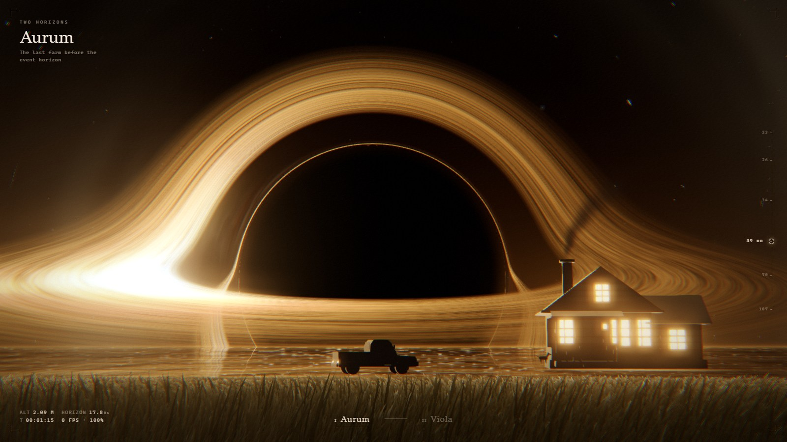

# Two Horizons

Wallpaper Engine web wallpaper made with three.js: a ray-traced Schwarzschild black hole (real light bending, Keplerian accretion disk with Doppler beaming, lensed stars) over two different worlds, switched from the menu at the bottom (or with the keys `1` / `2`):

- **I Aurum** – amber hole and disk, wheat blowing in the wind, a farmhouse with lit windows (and a dog on the porch), a pickup, sea-like mirror horizon, shooting stars and embers.
- **II Viola** – a thin pale disk and its lensing arc, a lavender field to the horizon with golden fireflies, an astronaut with their back to the camera, out-of-focus petals at the lens, a bright haze on the far ground.

It is one 3D world per scene: the black hole is a fixed object in the sky and the mouse only moves the camera, so grass, house, astronaut and hole slide against each other with correct depth.

Quality comes first: the default is full-quality per-pixel geodesic ray tracing. Lower the Quality option if your GPU struggles.



## Install in Wallpaper Engine

1. Wallpaper Engine → **Open Wallpaper Editor → Create Wallpaper**… or simply copy this folder to
   `Steam\steamapps\common\wallpaper_engine\projects\myprojects\TwoHorizons`.
2. In Wallpaper Engine press **Refresh**, pick *Two Horizons* from *My Wallpapers*.

The folder needs `project.json`, `index.html`, `dist/wallpaper.js` and `preview.jpg`. `dist/` is committed so no build is needed.

## Updating the installed copy

`powershell -File tools/deploy-we.ps1` copies the build into Wallpaper Engine **and restarts it**. A plain copy is not enough: Wallpaper Engine ignores `openWallpaper` for a wallpaper that is already running, so the desktop keeps showing the old version.

## Options (Wallpaper Engine properties)

Scene (Aurum / Viola / alternate every 45 s), Quality (Low / Medium / High), FPS limit, Glow, Animation speed, Mouse parallax, Stars, Light rays, HUD, Mouse control (Follow cursor / Drag / Off).

Controls:
- **Follow cursor** (default): the camera pans, drifts and rises a little with the pointer, no click needed. Wallpaper Engine passes mouse *movement* to a desktop wallpaper but usually swallows the *clicks* (Explorer's desktop icons take them), so the default does not depend on them.
- **Drag** (when the host delivers button events, e.g. `interactive.bat` in a window): drag sideways = pan, drag up = climb (ALT 1.1 m → 16 m, in Viola the camera also pulls back so the astronaut stays in view), double click = reset. Works in Follow mode too.
- **Lens**: mouse wheel, or the ruler on the right edge (23 – 107 mm). The wheel works on the desktop as well.
- **Scene**: click `I Aurum` / `II Viola`, press `1` / `2`, or use the Scene property (needed on the desktop, where clicks do not arrive).
- Arrow up / down also climb. With the HUD on, nothing else is shown except title, telemetry (ALT, HORIZON, time, FPS, render scale), ruler and menu.

Low quality drops the render scale, grass / flower counts and bloom.

## Develop

```bash
npm install
npm run build      # src/ -> dist/wallpaper.js (single IIFE, works from file://)
npm run serve      # http://127.0.0.1:8123  (?palette=violet&q=medium&fps=30)
```

`window.__capture()` returns a JPEG of the current frame (used to make `preview.jpg`).

## Layout

- `src/shaders.js` – sky/black hole (world-space rays), wheat, ground, flowers, fireflies, embers, grade (GLSL)
- `src/main.js` – Aurum scene, camera rig, scene switching, post-processing (bloom, tone map, grain), quality/properties, loop
- `src/viola.js` – Viola scene: flowers, field carpet, fireflies, astronaut, out-of-focus petals
- `src/hud.js` – title, telemetry, lens ruler, scene menu
- `tools/shot.sh` – headless Chrome screenshot (`tools/shot.sh out.png "scene=viola&t=30&alt=8"`); `freeze=1` stops after a few frames. URL parameters: `scene`, `q`, `t`, `alt`, `yaw`, `lens`, `cx`/`cy` (simulated cursor), `hud=0`

## 3D models

`assets/models/house.glb` (farmhouse with wing, porch, chimney) and `truck.glb` (pickup) were modelled in Blender through [Blender Copilot](https://github.com/halilogia/Blender-Copilot)'s MCP bridge; the scripts are in `tools/blender/`. `npm run build` embeds the `.glb` files into `dist/wallpaper.js` as data URLs, so the wallpaper needs no file access at run time. Materials named `glass` glow (windows, lamps); everything else is drawn as a rim-lit silhouette. The dog and the astronaut are built in code from primitives. (`build_models.py` can still build a windmill; it was removed from the scene because the reference does not have one.)
